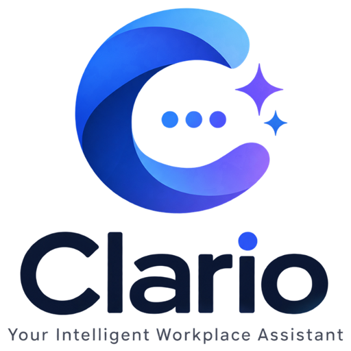
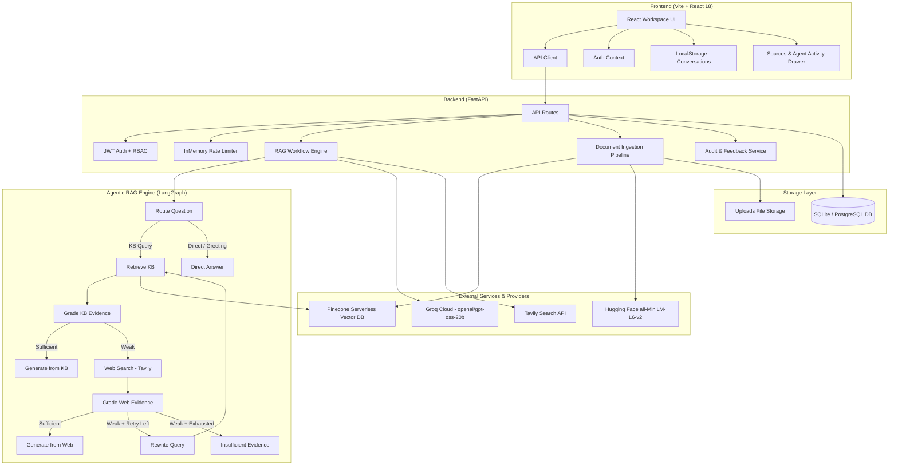
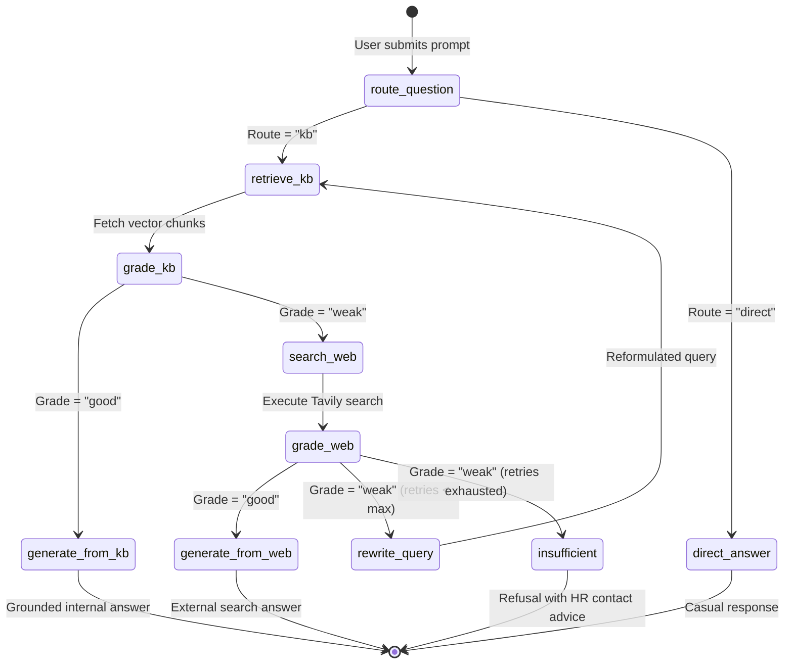

# Clario — Agentic RAG Workplace Knowledge Copilot

<div align="center">

<p>
  
</p>

### **Retrieve · Reason · Ground · Answer**
*Intelligent, evidence-grounded workplace assistance over organizational knowledge.*

[](https://react.dev/)
[](https://vitejs.dev/)
[](https://tailwindcss.com/)
[](https://fastapi.tiangolo.com/)
[](https://www.langchain.com/)
[](https://langchain-ai.github.io/langgraph/)
[](https://groq.com/)
[](https://www.pinecone.io/)
[](https://huggingface.co/)
[](https://tavily.com/)
[](https://www.sqlite.org/)
[](https://www.docker.com/)

</div>

---

## 📌 Project Aim & Motivation

Modern organizations maintain vast repositories of internal knowledge distributed across employee handbooks, workplace policies, benefits manuals, leave guidelines, and operational runbooks.

The primary operational challenge is not a scarcity of information — it is the friction of finding the **accurate, authoritative information at the point of need**.

Employees routinely need reliable answers to operational and workplace questions:

* *How many annual leave days do full-time employees accrue per quarter?*
* *What is the qualifying timeline and procedure for parental leave?*
* *What are the core reimbursement guidelines for remote office equipment?*
* *What does the employee handbook prescribe for secondary business activities?*

Traditional approaches present serious operational trade-offs:
1. **Manual Document Search:** Requires employees to search through dozens of disconnected PDF and Word files, leading to lost productivity and misinterpreted outdated clauses.
2. **Generic LLM Chatbots:** General-purpose commercial LLMs introduce severe **hallucination risks** — fabricating plausible but legally inaccurate policies not recognized by the organization.

### Clario solves this through Agentic Retrieval-Augmented Generation (Agentic RAG).

Clario empowers employees to converse naturally with organizational knowledge while ensuring responses are grounded in verified internal documents, with external web search fallback when internal coverage is absent. By employing an autonomous LangGraph decision loop with evidence grading, fallback web search, query rewriting, and explicit citation transparency, Clario delivers verified answers with an inspectable agent activity trace.

---

## 🚀 Core Features

### 🤖 1. Agentic RAG State Machine
Operates a 10-node LangGraph state machine that classifies queries, retrieves relevant context, evaluates evidence quality, triggers query reformulations, and accesses Tavily web search when internal knowledge is insufficient.

### 📚 2. Multi-Format Knowledge Base Ingestion
Directly ingests and processes organizational documentation across **PDF**, **DOCX**, **TXT**, and **Markdown** (`.md`) with recursive chunking and SHA-256 deduplication to prevent duplicate vectors.

### 🔎 3. Semantic Vector Search & Embeddings
Converts document chunks into dense 384-dimensional vector embeddings using Hugging Face's `all-MiniLM-L6-v2` model, indexed within Pinecone Serverless vector storage with namespace partitioning.

### 🧠 4. Evidence Grading & Fallback
Retrieved document chunks are graded for contextual relevance and completeness before generation. If internal evidence is weak, Clario falls back to Tavily web search or reformulates the query rather than hallucinating.

### 📖 5. Source Citations & Inspectable Agent Activity
Every response displays interactive citation pills linking to specific internal files or external URLs, paired with a slide-over drawer showing the agent's step-by-step reasoning and node transitions.

### 🔐 6. Secure Authentication & Role-Based Access Control (RBAC)
Complete employee self-registration and login with password hashing via `scrypt`, cryptographically signed stateless JWT access tokens, and role-based permissions separating employee chat from administrative tools.

### 📊 7. Audit Logging & User Feedback
Records queries, timestamps, user identities, evidence sources used, and agent traces in the database for compliance and analysis, alongside thumbs up/down user feedback collection.

### 🚦 8. Defensive Security & Rate Limiting
Thread-safe sliding-window rate limiting on authentication and chat endpoints, defensive HTTP security headers, strict file extension validation, and upload size caps.

---

## 🏛️ System Architecture

Clario uses a decoupled architecture featuring a modern React single-page application and a high-performance Python FastAPI service:



---

## 🔄 End-to-End Architectural Flow

### 1. User Authentication & Workspace Access
* Corporate employees create accounts via public self-registration (`/api/v1/auth/register`) or sign in with their existing credentials (`/api/v1/auth/login`).
* Passwords are authenticated against salted `scrypt` hashes, and the server generates a cryptographically signed HMAC-SHA256 JWT access token.
* The frontend `AuthContext` injects the bearer token into subsequent requests. Role-based middleware enforces access rules across administrative and employee endpoints.

### 2. Document Ingestion & Knowledge Base Creation
* Administrators upload organizational policies through the Documents interface or `/api/v1/ingest`.
* The server validates file extensions (`.pdf`, `.docx`, `.txt`, `.md`), enforces a 10 MB maximum file size, and computes a SHA-256 hash to prevent duplicate ingestion.
* Text content is extracted, recursively split into overlapping chunks, converted into dense 384-dimensional embeddings using `all-MiniLM-L6-v2`, and indexed into Pinecone with document metadata.

### 3. Agentic Query Routing & Knowledge Retrieval
* When an employee asks a question in the workspace chat, the LangGraph workflow initiates at the `route_question` node.
* A structured router prompt classifies whether the query pertains to organizational policies (`kb`) or is general conversational chit-chat (`direct`).
* Conversational inquiries bypass vector search entirely and receive a direct response. Policy inquiries query Pinecone using cosine similarity to fetch the most relevant text chunks.

### 4. Evidence Validation, Web Search & Query Rewriting
* The `grade_kb` node evaluates whether the retrieved document chunks contain sufficient specific information to answer the question authoritatively.
* If internal evidence is validated as sufficient, the pipeline proceeds directly to grounded generation.
* If internal evidence is weak or missing, the workflow initiates a fallback to Tavily Web Search and grades the returned external results (`grade_web`).
* If external results are also weak, the query rewriter reformulates the user prompt with policy keywords and retries internal retrieval. Once retries are exhausted without viable evidence, the system refuses gracefully with an `insufficient` response rather than hallucinating.

### 5. Grounded Response Generation & Source Transparency
* For verified internal evidence, the Groq-hosted `openai/gpt-oss-20b` model generates an answer strictly constrained by the retrieved document chunks.
* The system constructs citation metadata linking the answer back to original file names and chunk indices.
* For web-fallback answers, the output explicitly indicates that external public sources were consulted and suggests employee verification with HR.

### 6. Agent Activity, Audit Logging & Feedback
* Every interaction is recorded by the backend audit service, capturing the employee ID, question, source classification (`private_kb`, `web_search`, `direct`, `insufficient_evidence`), and execution trace.
* The frontend renders interactive source chips and a slide-over drawer displaying the exact progression of graph nodes.
* Employees can rate responses with thumbs-up/thumbs-down feedback, which is stored in the database for knowledge base maintenance.

---

## 🧠 Agentic RAG: Why Clario Goes Beyond Simple RAG

Standard ("naive") RAG systems follow a rigid, linear sequence: query $\rightarrow$ vector search $\rightarrow$ LLM generation. This approach frequently fails in enterprise workplace environments because:

1. **Blind Retrieval:** Vector search is triggered for greetings or questions unrelated to company policy.
2. **Context Hallucination:** Irrelevant retrieved chunks still get fed to the LLM, leading to inaccurate answers.
3. **Information Gaps:** When internal documentation has not yet been authored for a topic, simple RAG hallucinates or fails completely.
4. **Poor Keyword Alignment:** Employee phrasing often diverges from formal policy terminology, causing semantic search misses.

### Simple RAG vs. Clario Agentic RAG

| Architectural Dimension | Naive / Simple RAG | Clario Agentic RAG |
| :--- | :--- | :--- |
| **Query Routing** | ❌ None (all queries retrieve vectors) | ✅ Dynamic LLM router separates policy queries from direct conversation |
| **Evidence Grading** | ❌ Unchecked (assumes top results are relevant) | ✅ Context graded (`good` / `weak`) prior to answer synthesis |
| **Hallucination Prevention** | ⚠️ Weak (relies purely on system prompts) | ✅ Multi-gate evaluation; rejects insufficient context |
| **External Fallback** | ❌ None (fails if not in vector index) | ✅ Tavily Web Search fallback with secondary evidence grading |
| **Query Reformulation** | ❌ Static (single-shot failure) | ✅ Automated query rewriting loop with keyword expansion |
| **Observability** | ❌ Black-box output | ✅ Step-by-step inspectable execution trace exposed in the UI |

### LangGraph Agent State Machine



---

## 📄 Knowledge Base & Document Ingestion

Clario provides an automated document ingestion pipeline for organizational policy documents:

* **Supported Formats:** Portable Document Format (`.pdf` via `pypdf`), Microsoft Word (`.docx` via `python-docx`), Markdown (`.md`), and Plain Text (`.txt`).
* **Format Scope:** Ingestion processes text-encoded files directly. Scanned bitmap PDFs or image-only documents without embedded OCR text streams are not supported.
* **Size Enforcement:** Uploads are strictly capped at 10 MB (`settings.max_upload_bytes`). Oversized files are rejected with HTTP 413.
* **SHA-256 Deduplication:** The raw byte stream is hashed with SHA-256 before indexing. If a matching content hash exists, the upload is rejected with HTTP 409 to prevent duplicate vector storage.
* **Text Chunking:** Extracted text is split using `RecursiveCharacterTextSplitter` with balanced paragraph boundaries and overlap to preserve semantic context across chunk edges.
* **Dense Vector Embeddings:** Text chunks are transformed into 384-dimensional dense vectors using Hugging Face `all-MiniLM-L6-v2`.
* **Pinecone Serverless Indexing:** Vectors are stored in a Pinecone Serverless index with AWS `us-east-1` deployment, cosine distance metric, and namespace isolation (`company-hr-kb`), complete with document ID, filename, and chunk index metadata.

---

## 👥 Role-Based Access Control (RBAC)

Clario enforces strict Role-Based Access Control on both the backend API layer and frontend routing:

| System Capability | Employee (`employee`) | System Admin (`system_admin` / `hr_admin`) |
| :--- | :---: | :---: |
| **Self-Registration & Profile** | ✅ Yes (`/auth/register`, `/auth/me`) | ✅ Yes |
| **Password Login & Token Refresh** | ✅ Yes (`/auth/login`, `/auth/refresh`) | ✅ Yes |
| **Workplace Copilot Chat** | ✅ Yes (`/chat`) | ✅ Yes |
| **Interactive Citations & Agent Trace** | ✅ Yes | ✅ Yes |
| **Thumbs Up/Down Feedback** | ✅ Yes (`/feedback`) | ✅ Yes |
| **Conversation History (LocalStorage)** | ✅ Own browser session | ✅ Own browser session |
| **List Knowledge Base Documents** | ❌ HTTP 403 Forbidden | ✅ Full Access (`/documents`) |
| **Upload & Index Documents** | ❌ HTTP 403 Forbidden | ✅ Full Access (`/ingest`) |
| **Delete Documents & Vector Cleanup** | ❌ HTTP 403 Forbidden | ✅ Full Access (`/documents/{id}`) |
| **Inspect Query Audit Logs** | ❌ HTTP 403 Forbidden | ✅ Full Access (`/audit`) |
| **View Audit Statistics & Analytics** | ❌ HTTP 403 Forbidden | ✅ Full Access (`/audit/stats`) |

* **Self-Registration Role Enforcement:** Employee registration via `POST /api/v1/auth/register` hardcodes `role = "employee"`, blocking any client-side attempt at administrative privilege escalation.
* **Admin Bootstrapping:** System administrator accounts cannot be registered publicly and are provisioned via environment configuration (`BOOTSTRAP_ADMIN_EMAIL`, `BOOTSTRAP_ADMIN_PASSWORD`).

---

## 💻 Tech Stack & Libraries

### Frontend
* **Core Framework:** React 18.3, Vite 5.4
* **Styling & Design System:** Tailwind CSS 3.4, PostCSS, Autoprefixer
* **UI Icons:** Lucide React
* **Markdown Rendering:** React-Markdown 9.0, Remark-GFM 4.0
* **Routing & State:** React Router DOM 6.27, React Context (`AuthContext`)
* **Persistence:** Browser `localStorage` for conversation threads

### Backend
* **Runtime & Framework:** Python 3.10+, FastAPI 0.116+, Uvicorn 0.35+
* **Validation & Settings:** Pydantic 2.x, Pydantic-Settings 2.10
* **ORM & Database:** SQLAlchemy 2.0, Alembic 1.14
* **Drivers:** SQLite 3 (default local development), Psycopg 3.2 (PostgreSQL)
* **File Processing:** PyPDF 6.16, Python-Docx 1.2, Python-Multipart 0.0.20

### AI & Agentic RAG
* **Workflow Orchestration:** LangGraph 1.1+, LangChain Core 1.6+
* **LLM Provider:** ChatGroq (`openai/gpt-oss-20b`)
* **Embedding Model:** Hugging Face `all-MiniLM-L6-v2` (`sentence-transformers`)
* **Vector Database:** Pinecone (`pinecone==7.3.0`, `langchain-pinecone`)
* **Web Search Fallback:** Tavily Search (`langchain-tavily==0.2.18`)
* **Text Chunking:** LangChain Text Splitters (`RecursiveCharacterTextSplitter`)

### Security & Infrastructure
* **Password Hashing:** `scrypt` key derivation function
* **Token Signatures:** Custom HMAC-SHA256 JWT
* **Rate Limiting:** In-memory sliding-window bucket rate limiter with thread lock
* **Containerization:** Docker multi-stage builds, Docker Compose

---

## 📂 Repository Structure

```
Clario/
├── app/
│   ├── api/
│   │   ├── __init__.py
│   │   └── routes.py             # FastAPI REST endpoints (auth, chat, docs, audit)
│   ├── core/
│   │   ├── __init__.py
│   │   ├── config.py             # Pydantic BaseSettings & configuration loader
│   │   ├── database.py           # SQLAlchemy engine, session maker & declarative Base
│   │   ├── logging.py            # Structured console logging configuration
│   │   ├── rate_limit.py         # Thread-safe in-memory sliding window rate limiter
│   │   └── security.py           # scrypt password hashing & custom JWT issuance/decoding
│   ├── rag/
│   │   ├── __init__.py
│   │   ├── state.py              # LangGraph AgentState and Pydantic grading schemas
│   │   ├── vector_store.py       # Pinecone index lifecycle & HuggingFace embedding client
│   │   └── workflow.py           # 10-node LangGraph Agentic RAG state machine
│   ├── services/
│   │   ├── __init__.py
│   │   ├── audit.py              # Audit log writer & database table initializer
│   │   └── ingestion.py          # Multi-format document loader & recursive chunker
│   ├── main.py                   # FastAPI application factory, CORS & security headers
│   └── models.py                 # SQLAlchemy ORM models (User, DocumentRecord, QueryAudit, Feedback)
├── data/
│   ├── clario.db                 # SQLite local development database (auto-created)
│   └── sample_kb/                # Pre-packaged sample organizational policy documents
├── frontend/
│   ├── public/                   # Static branding assets, icons, and logos
│   ├── src/
│   │   ├── api/                  # Axios/fetch API client wrapper with JWT interceptor
│   │   ├── components/           # Modular UI components (auth, chat, layout, sources, trace)
│   │   ├── context/              # AuthContext (token storage, login, logout, user profile)
│   │   ├── hooks/                # Custom React state and event hooks
│   │   ├── pages/                # Page views (Auth, Chat, Documents, Activity, Settings)
│   │   ├── App.jsx               # Top-level router with protected routes
│   │   └── index.css             # Tailwind CSS entrypoint and custom utilities
│   ├── Dockerfile                # Multi-stage Node.js build to Nginx Alpine
│   ├── package.json              # Frontend npm dependencies and build scripts
│   └── vite.config.js            # Vite bundler configuration and proxy settings
├── tests/
│   ├── __init__.py
│   └── test_api.py               # Automated unit and integration test suite
├── uploads/                      # Ingested organizational documents storage directory
├── .dockerignore                 # Docker build exclusions
├── .env.example                  # Environment configuration template
├── .gitignore                    # Git version control exclusions
├── Dockerfile                    # Backend Python 3.12-slim container specification
├── docker-compose.yml            # Multi-service stack (PostgreSQL, Backend, Frontend)
├── ingest_sample_kb.py           # Standalone CLI utility to index sample_kb/ into Pinecone
├── requirements.txt              # Production Python package dependencies
└── run.py                        # Uvicorn entry point script for local development
```

---

## 🚀 Step-by-Step Local Setup

### 1. Prerequisites
* **Python:** 3.10, 3.11, or 3.12 (`python --version`)
* **Node.js:** v18+ or v20+ (`node -v`) with npm
* **Git:** Version control client
* **API Keys:**
  * [Groq Cloud API Key](https://console.groq.com/) (LLM inference)
  * [Pinecone API Key](https://app.pinecone.io/) (vector store)
  * [Tavily Search API Key](https://app.tavily.com/) (web search fallback)

---

### 2. Environment Configuration
Clone the repository and copy the environment template:

```bash
git clone https://github.com/Abhishekkhulbe2228/Clario.git
cd Clario
cp .env.example .env
```

Configure the required variables in `.env`:

```dotenv
# Required API Keys
GROQ_API_KEY=gsk_your_groq_api_key_here
PINECONE_API_KEY=pcsk_your_pinecone_api_key_here
TAVILY_API_KEY=tvly-your_tavily_api_key_here

# Security
JWT_SECRET=generate_a_long_random_secret_string_here_min_32_chars

# Administrator Account (Bootstrap)
BOOTSTRAP_ADMIN_EMAIL=admin@example.com
BOOTSTRAP_ADMIN_PASSWORD=AdminSecurePassword123!
```

---

### 3. Backend Setup & Startup

1. Create and activate a Python virtual environment:

```bash
# Windows (PowerShell)
python -m venv venv
.\venv\Scripts\activate

# macOS / Linux
python3 -m venv venv
source venv/bin/activate
```

2. Install dependencies:

```bash
pip install -r requirements.txt
```

3. Start the backend service:

```bash
python run.py
```

* API service runs at: `http://127.0.0.1:8000`
* Interactive OpenAPI documentation: `http://127.0.0.1:8000/docs`
* Health check endpoint: `http://127.0.0.1:8000/api/v1/health`

*(Optional)* Index the sample policy documents into Pinecone:

```bash
python ingest_sample_kb.py
```

---

### 4. Frontend Setup & Startup

1. In a separate terminal, navigate to the frontend folder:

```bash
cd frontend
```

2. Install npm packages:

```bash
npm install
```

3. Launch the Vite development server:

```bash
npm run dev
```

* Frontend application runs at: `http://localhost:5173`

---

### 5. Running with Docker Compose

To launch the full containerized environment with a dedicated PostgreSQL database:

```bash
docker-compose up --build
```

* **Frontend:** `http://localhost:5173`
* **Backend:** `http://localhost:8000`

---

## ⚙️ Environment Variables Reference

| Variable Name | Required | Default Value | Description |
| :--- | :---: | :--- | :--- |
| `APP_NAME` | No | `Clario` | Service name identifier |
| `ENVIRONMENT` | No | `development` | Deployment environment (`development` / `production`) |
| `DATABASE_URL` | No | `sqlite:///data/clario.db` | SQLAlchemy connection string (SQLite or PostgreSQL) |
| `CORS_ORIGINS` | No | `http://localhost:5173,http://127.0.0.1:5173` | Allowed CORS origins for browser clients |
| `JWT_SECRET` | **Yes** | `""` | Cryptographic secret key used to sign JWT access tokens |
| `BOOTSTRAP_ADMIN_EMAIL` | **Yes** | `""` | Email for bootstrap system administrator account |
| `BOOTSTRAP_ADMIN_PASSWORD` | **Yes** | `""` | Password for bootstrap system administrator |
| `BOOTSTRAP_EMPLOYEE_EMAIL` | No | `employee@company.com` | Optional email for pre-seeded employee account |
| `BOOTSTRAP_EMPLOYEE_PASSWORD` | No | `""` | Password for pre-seeded employee account |
| `GROQ_API_KEY` | **Yes** | `""` | Groq Cloud API key for LLM inference |
| `GROQ_MODEL` | No | `openai/gpt-oss-20b` | Model identifier hosted on Groq |
| `EMBEDDING_MODEL` | No | `all-MiniLM-L6-v2` | Hugging Face embedding model name |
| `PINECONE_API_KEY` | **Yes** | `""` | Pinecone API key for vector storage |
| `PINECONE_INDEX_NAME` | No | `hr-policy-rag` | Name of the Pinecone vector index |
| `PINECONE_NAMESPACE` | No | `company-hr-kb` | Partition namespace within the index |
| `TAVILY_API_KEY` | **Yes** | `""` | Tavily API key for web search fallback |
| `POSTGRES_PASSWORD` | Docker | `""` | PostgreSQL database password for Docker Compose |

---

## 📡 API Reference Overview

All REST API endpoints are prefixed with `/api/v1` (except the root health check):

| Module | Method | Endpoint | Access Role | Description |
| :--- | :---: | :--- | :---: | :--- |
| **System** | `GET` | `/api/v1/health` | Public | Service health status and database connectivity check |
| **Auth** | `POST` | `/api/v1/auth/login` | Public (Rate Limited) | Authenticate with email/password; returns JWT bearer token |
| **Auth** | `POST` | `/api/v1/auth/register` | Public (Rate Limited) | Self-register employee account (enforced as `employee`) |
| **Auth** | `POST` | `/api/v1/auth/refresh` | Authenticated | Refresh JWT access token for active session |
| **Auth** | `GET` | `/api/v1/auth/me` | Authenticated | Retrieve authenticated user profile (id, email, name, role) |
| **Chat** | `POST` | `/api/v1/chat` | Authenticated (Rate Limited) | Submit natural-language question to Agentic RAG workflow |
| **Feedback**| `POST` | `/api/v1/feedback` | Authenticated | Submit thumbs-up / thumbs-down rating and optional comment |
| **Documents**| `GET` | `/api/v1/documents` | Admin Only | List all indexed organizational documents with chunk counts |
| **Documents**| `POST` | `/api/v1/ingest` | Admin Only | Upload, parse, chunk, embed, and index a policy document |
| **Documents**| `DELETE`| `/api/v1/documents/{document_id}` | Admin Only | Delete document record, disk file, and associated Pinecone vectors |
| **Audit** | `GET` | `/api/v1/audit` | Admin Only | Paginated query audit logs with questions, sources, and traces |
| **Audit** | `GET` | `/api/v1/audit/stats` | Admin Only | Aggregate metrics (total queries, KB hits, web fallbacks, refusals) |

---

## 🛡️ Security & Privacy

* **Password Security:** Passwords are hashed using the memory-hard `scrypt` key derivation function with random salt. Plaintext passwords are never stored or logged.
* **Stateless Token Authorization:** Authentication utilizes stateless HMAC-SHA256 signed JWT tokens containing user ID, email, role, and expiration timestamp.
* **Role Enforcement Middleware:** Administrative operations (`/documents`, `/ingest`, `/audit`) use FastAPI dependency injection (`require_roles("system_admin", "hr_admin")`), rejecting unauthorized employee requests with HTTP 403.
* **Defensive HTTP Headers:** All responses include security headers: `X-Content-Type-Options: nosniff`, `X-Frame-Options: DENY`, `Referrer-Policy: strict-origin-when-cross-origin`, and `Permissions-Policy`.
* **File Upload Controls:** File uploads are restricted to an explicit extension whitelist (`.pdf`, `.docx`, `.txt`, `.md`), capped at 10 MB, deduplicated via SHA-256, and stored with sanitized UUID filenames.
* **In-Memory Rate Limiting:** Sensitive endpoints implement an in-memory sliding-window bucket rate limiter:
  * Login: 10 requests / 60 seconds per IP
  * Register: 5 requests / 60 seconds per IP
  * Chat: 20 requests / 60 seconds per IP
  * Exceeding limits triggers an immediate `HTTP 429 Too Many Requests`.

> ⚠️ *Rate Limiter Note:* The built-in rate limiter is an in-memory implementation suited for single-process instances. Counter state resets on server restart and is not shared across multi-worker clusters. For distributed multi-node deployments, Redis-backed rate limiting is recommended.

---

## 🧪 Testing

Clario includes an automated regression test suite covering authentication, RBAC boundaries, rate limiting, and chat execution:

### 1. Running Backend Tests
Execute the Python test suite using Python's built-in `unittest` runner:

```bash
python -m unittest tests/test_api.py
```

* **Automated Coverage:** 18 automated unit and integration tests verifying health checks, authentication, JWT validity and expiration, role-based boundary enforcement (HTTP 403 on admin routes), chat flow with mocked vector retrieval and citations, user feedback recording, registration input validation, duplicate email rejection (HTTP 409), and sliding-window rate limiting (HTTP 429).

### 2. Frontend Build Verification
Verify production asset compilation and bundling:

```bash
npm --prefix frontend run build
```

* Compiles the production bundle via Vite 5 (`dist/index.html`, minified JavaScript and CSS) with zero syntax or bundling errors.

---

## ⚠️ Known Limitations

1. **Client-Side Conversation Storage:** Chat conversation histories are persisted in browser `localStorage`. Conversations do not automatically synchronize across different browsers or separate devices.
2. **In-Memory Rate Limiting:** The default rate limiter stores sliding-window timestamps in local process memory. Restarting the server resets counters, and rate limits are not shared across multi-process or multi-container deployments.
3. **Text-Encoded Ingestion Only:** Supported file formats (PDF, DOCX, TXT, MD) extract encoded text. Scanned documents consisting solely of rasterized image bitmaps without an embedded OCR text layer cannot be parsed without external OCR tooling.
4. **Retry Loop Bound:** To prevent infinite query reformulation cycles, the agentic retry loop is capped by `settings.max_retries` (default: 1). If both initial retrieval and the retry fail, the agent defaults to refusal.

---

## 🔮 Future Scope

* **Server-Side Conversation Persistence:** Synchronize conversation history and thread management across employee devices via encrypted database storage.
* **Distributed Rate Limiting:** Transition from in-memory rate limiting to a Redis-backed token bucket implementation for multi-node deployments.
* **Multimodal OCR Ingestion:** Integrate optical character recognition (e.g., Tesseract or vision models) to parse scanned documents and infographic policies.
* **Granular Knowledge Access Controls:** Introduce department-level access tags (e.g., Engineering, Sales, HR) to restrict knowledge retrieval according to organizational sub-teams.
* **Automated RAG Evaluation:** Integrate evaluation frameworks (such as Ragas or TruLens) directly into the administrative dashboard to track answer faithfulness and hallucination rates over time.

---

## 📄 License

Clario is released under the [Apache License 2.0](LICENSE).
